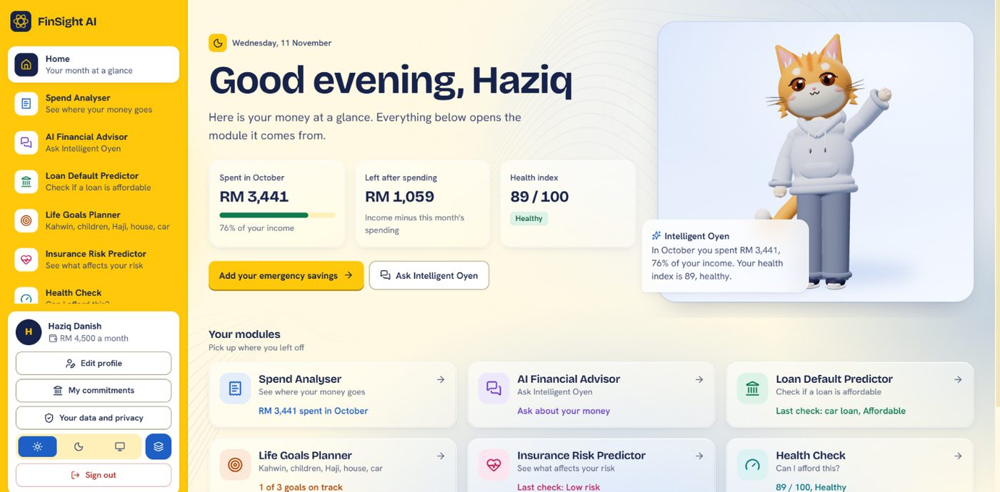
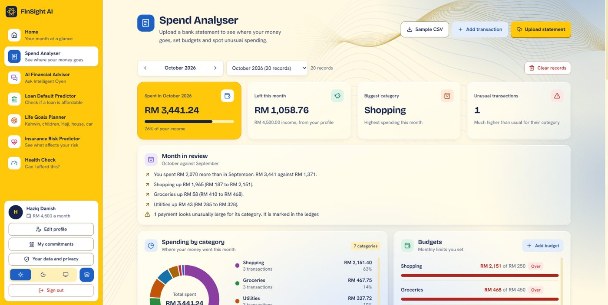
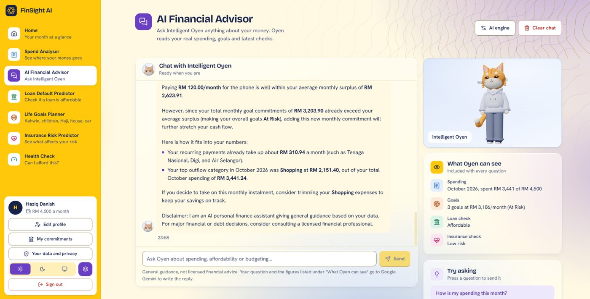
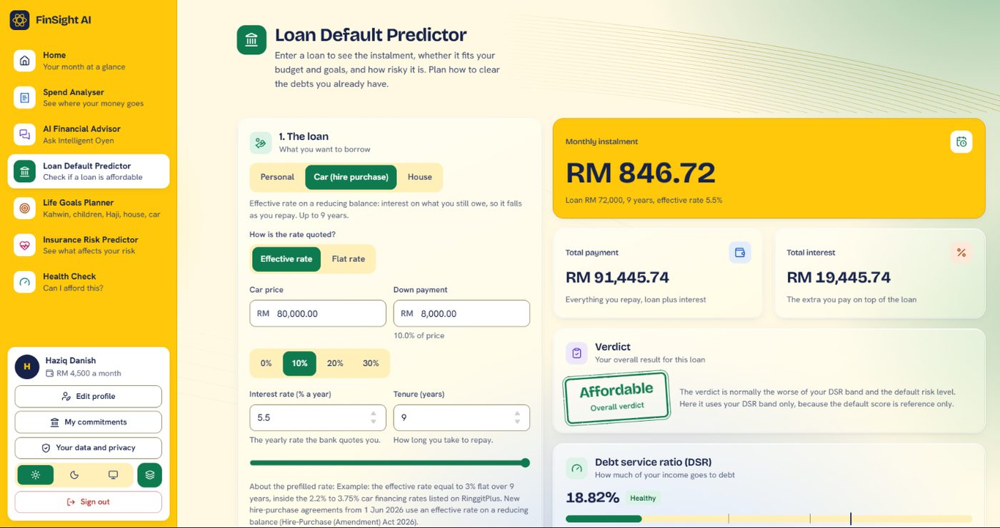
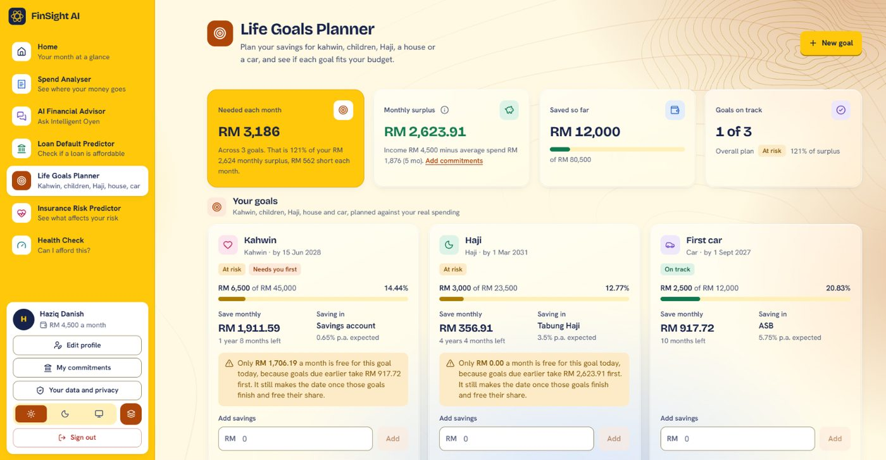
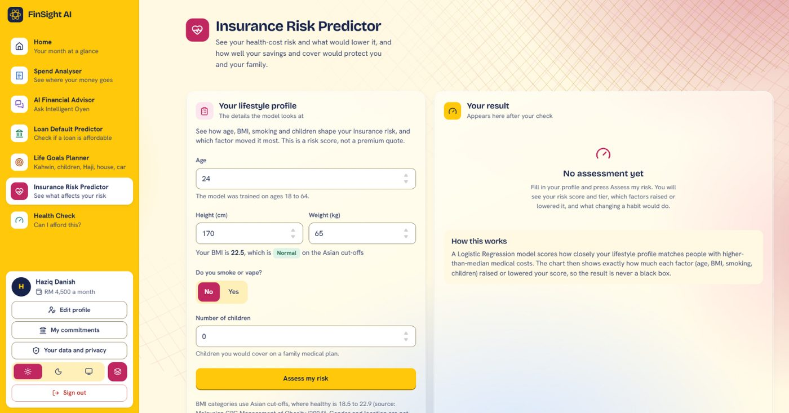
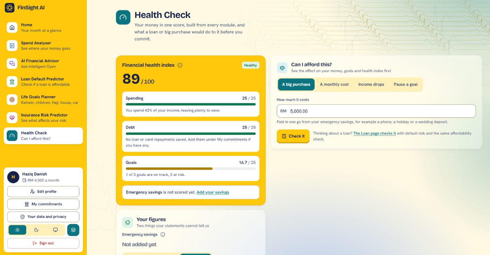

# FinSight AI

**An AI-powered personalised financial management web app for Malaysians aged 18 to 40.**

Upload a real bank statement and get one dashboard that covers your spending, loans, life goals and insurance risk, with an AI advisor that answers from your own numbers.

Final Year Project, Bachelor of Computer Science (Hons.) Netcentric Computing, Universiti Teknologi MARA (UiTM) Shah Alam. Supervised by Assoc. Prof. Ts. Dr. Nor Shahniza Kamal Bashah.



---

## Why

- Only about a third of Malaysians understand basic financial concepts, and over half could not survive 3 months without income.
- The biggest expenses young Malaysians face (kahwin, children, Haji, a house, a car) are usually saved for informally, with no plan.
- No local app joins spend tracking, loan risk, insurance risk and culturally relevant goal planning in one place.

FinSight answers one question across all of them: **"Can I afford this, and what does it do to the rest of my finances?"**

---

## Modules

| # | Module | What it does | AI / ML | Result |
|---|--------|--------------|---------|--------|
| 1 | **Spend Analyser** | Reads PDF e-statements, CSV and XLSX; categorises every transaction; budgets, 50/30/20 check, recurring payments, next-month forecast | TF-IDF + Logistic Regression merged with keyword rules (Random Forest compared); Z-score anomaly flags | **72.1%** accuracy on merchants the model never saw, vs 44.8% for rules alone |
| 2 | **AI Financial Advisor** | Chat that reads your real spending, goals, loan and insurance checks | LLM (Gemini / OpenAI) with figures computed in code and a reply validator | Replies with untraceable figures: **0/16** vs 6/16 for a plain prompt |
| 3 | **Loan Default Predictor** | Instalment, total interest, DSR and default risk before you apply (flat vs reducing balance, 2026 rules) | XGBoost on Lending Club, leakage-free features only | ROC-AUC **0.697** (honest: no lender grade or rate used) |
| 4 | **Life Goals Planner** | Savings plans for Kahwin, Children, Haji, House and Car; Tabung Haji, ASB and gold compared | ARIMA gold price forecast + feasibility from your real surplus | 12-month MAPE **11.6%** vs 18.4% naive |
| 5 | **Insurance Risk Predictor** | How age, BMI, smoking and children shape your insurance risk, with what-if scenarios and a protection gap | Logistic Regression + exact SHAP explanations | ROC-AUC **0.953**, accuracy 89.9% |
| + | **Financial Health Check** | One health index from every module and a "Can I afford this?" simulator (purchase, new commitment, income drop) | Deterministic simulator across all modules | Ties every module together |

Tested on real e-statements from **AEON Bank, Bank Islam, CIMB and Maybank**: 100% of rows reconcile with the running balance.

---

## Screenshots

| Spend Analyser | AI Financial Advisor |
|---|---|
|  |  |
| **Loan Default Predictor** | **Life Goals Planner** |
|  |  |
| **Insurance Risk Predictor** | **Financial Health Check** |
|  |  |

---

## Architecture

```
React + Vite (client)
        │  REST/JSON + JWT
Express API (Node.js)  ── auth, uploads, PDF parsing, loan & savings maths, LLM calls
   │              │  internal HTTP
 MySQL      FastAPI ML service (Python)
             /predict/category   Logistic Regression
             /predict/loan       XGBoost
             /predict/insurance  Logistic Regression + SHAP
             /forecast/gold      ARIMA
```

The browser only talks to Express. The ML service is stateless and internal, so each side can be scaled or replaced on its own. If the ML service is down, the app falls back to rules instead of failing.

## Tech stack

- **Frontend:** React 19, Vite, Tailwind CSS v4, Recharts, three.js (3D mascot)
- **Backend:** Node.js, Express, MySQL, JWT, bcrypt, pdf.js
- **ML service:** Python, FastAPI, scikit-learn, XGBoost, statsmodels, pandas
- **AI:** Google Gemini / OpenAI
- **Deploy:** Docker Compose, Caddy (HTTPS), encrypted daily backups ([DEPLOY.md](DEPLOY.md))

---

## Evaluation

| Area | How | Result |
|------|-----|--------|
| Functional | 144 automated test cases against the real API | 144/144 pass |
| Unit | `node --test` on the services | 106/106 pass |
| Performance | API latency, upload size, 25 concurrent users, Lighthouse | Read endpoints p95 ≤ 14 ms, 0 failures under load, Lighthouse desktop 100 / mobile 95 |
| ML | Merchant-grouped CV, held-out test sets, rolling backtests, baselines for every model | See the Modules table |
| Advisor | 16 questions × 3 prompt set-ups with real Gemini | Expected figure present 10/10 vs 5/10 baseline |

Full write-ups are in [`evaluation/results/`](evaluation/results/).

### Limitations (stated honestly)

- Loan and insurance models are trained on US data (Lending Club, Medical Cost Personal), so they rank risk; they do not quote ringgit prices. Long car and house loans fall outside the loan data, so their score is shown as reference only.
- The categoriser's training text is generated from a hand-built Malaysian merchant list, because no labelled Malaysian bank dataset is public.
- Estimates only, not financial advice.

---

## Run locally

Requirements: Node.js 20+, Python 3.14 (what it was built and tested on), MySQL (XAMPP works).

```bash
# 1. Database: start MySQL and import server/schema.sql

# 2. API
cd server
cp .env.example .env        # set JWT_SECRET, DB_*, and GEMINI_API_KEY (optional)
npm install && npm run dev  # http://localhost:5000

# 3. Client
cd client
npm install && npm run dev  # http://localhost:5173

# 4. ML service
cd ml-service
python -m venv .venv && .venv/Scripts/pip install -r requirements.txt
.venv/Scripts/python -m uvicorn main:app --port 8000
```

Without a Gemini key the advisor uses an offline rule-based fallback. Without the ML service, categorisation falls back to rules.

---

## Author

**Muhammad Haziq Danish** · [LinkedIn](https://www.linkedin.com/in/ziqd) · [GitHub](https://github.com/zeeqy)
